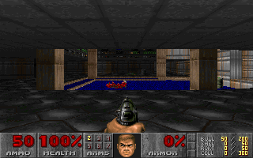

# Setun-Doom: 21-Trit Balanced Ternary Computer Emulator Running Doom (1993)



**Setun-Doom** is a gate-level balanced ternary computer architecture emulator (`{-1, 0, +1}`) written in Rust that executes classic **Doom (1993)** (`DOOM1.WAD` via `doomgeneric`). It synthesizes historical Soviet balanced ternary architectures (**Setun-1958** and **Setun-70** by Nikolai Brusentsov, Moscow State University) with modern ternary RISC extensions (**REBEL-2** and **REBEL-6**, IEEE ISMVL 2025) and **J. Ramil Alvarez's (1974)** recurrent $p \to p \pm 1$ hardware base converter.

---

## Architectural Highlights

* **21-Trit Word (`Word21`)**:
  * $3^{21} = 10,460,353,203$ symmetric states in $[-5,230,176,601,\; +5,230,176,601]$.
  * Gate-level combinational ternary logic (`Trit::invert`, `Trit::t_and`, `Trit::t_or`, `Trit::t_mul`, `Trit::consensus`, `Trit::sum_mod3`, `Trit::half_add`, `Trit::full_add`, `Trit::majority_vote`, `Trit::minority_vote`, `Trit::threshold_add`, `Trit::masked_inhibit`, `Trit::cmp_trit`).
  * 21-stage Ripple-Carry Adder (`Word21::gate_ripple_carry_add`) and $21 \times 21 \to 42$-trit Shift-and-Add/Subtract Multiplier (`Word21::gate_shift_and_add_mul42`) where `Trit::Zero` multiplier digits bypass partial-product addition with zero gate switching.
* **Balanced Ternary Fixed-Point (`TernaryFixed` `11.10`)**:
  * Replaces Doom's binary `16.16` `fixed_t` ($2^{16} = 65,536$) with a symmetric **11-trit integer, 10-trit fractional** representation (scale $3^{10} = 59,049$).
  * Physical 10-trit wire slicing (`prod42[10..31]`) performs exact round-to-nearest division by $3^{10}$ without a rounding adder or negative truncation bias (`RMSE = 0.0000` vs binary `16.16` `RMSE = 0.7085`).
* **36-Opcode Orthogonal Ternary ISA**:
  * **Instruction Format (`Word21`)**: `trits[0..13]` (14-trit operand/address, $3^{14} = 4,782,969$ words), `trits[14..15]` (2-trit register/mode selector, $3^2 = 9$ states), `trits[16..20]` (5-trit opcode).
  * **Setun-1958 & Setun-70 Instructions**: `MUL` (`++0` `MULTIPLICATION_ZERO` / `L*T` `B26`), `MAC_POS` (`+++` / `LBT` `B25`), `MAC_NEG` (`++-`), `LOAD_R` (`+-+` / `YRT`), `SMT` (`+-0` / `B19` tritwise multiply), `SAT` (`B21` threshold addition), `SIT` (`B20` $S + T(1 - |S|)$), `BIX` (index loop branch).
  * **REBEL-6 & REBEL-2 Instructions** (adapted from the 32-trit REBEL-6 ISA to this 21-trit word, see [`docs/rebel6.md`](docs/rebel6.md)): `CMP.T` (`<=>` comparator), `MAJV.T` (majority vote), `MINV.T` (minority vote), `STI.T` (wire inverter), `BCEG` (single-cycle 3-way branch compare equal or greater with two 7-trit relative offsets, from REBEL-2).
  * **Zero Silent Failures**: Hardware `CpuTrap` exceptions (`InvalidInstruction`, `DivisionByZero`, `MemoryFault`) enforce strict 14-trit memory bounds and trap invalid opcodes or division by zero.
* **Resident Ternary Firmware ROM (`SetunMemory`)**:
  * `ROM_FIXED_MUL_ENTRY` (`PC = 100`), `ROM_FIXED_DIV_ENTRY` (`PC = 120`), `ROM_POINT_ON_SIDE_ENTRY` (`PC = 140`, using Setun-58 `MUL` + `LOAD_R` + `MAC_NEG`), and `ROM_APROX_DIST_ENTRY` (`PC = 220`, using `STI.T` + `CMP.T`) execute Doom's BSP traversal, geometry, and fixed-point math directly through `Cpu::step_checked`.

---

## 36-Opcode Ternary ISA Table

The Setun-Doom CPU implements 36 authentic opcodes utilizing a 21-trit instruction format: `trits[0..13]` (14-trit address/operand, $3^{14} = 4,782,969$ reach), `trits[14..15]` (2-trit index register `IX0..IX8`), and `trits[16..20]` (5-trit opcode in $[-121, +121]$).

| Opcode | Mnemonic | Trit Field | Operation Semantics | Architectural Origin |
| :---: | :--- | :---: | :--- | :--- |
| `0` | **NOP** | `00000` | No operation (empty execution cycle) | Setun-58 |
| `+1` | **ADD** | `0000+` | `ACC = ACC + MEM[addr]` | Setun-58 |
| `-1` | **SUB** | `0000-` | `ACC = ACC - MEM[addr]` | Setun-58 |
| `+2` | **MUL** | `000+-` | `ACC = FixedMul(ACC, MEM[addr])` ($11.10$ symmetric fixed-point) | Setun-58 (`++0`) |
| `-2` | **DIV** | `000-+` | `ACC = FixedDiv(ACC, MEM[addr])` ($11.10$ symmetric fixed-point) | Setun-58 (`--0`) |
| `+3` | **NEG** (`STI.T`) | `000+0` | `ACC = -ACC` (instantaneous wire inversion without carry propagation) | Setun-58 / REBEL-6 |
| `+4` | **LOAD** | `000++` | `ACC = MEM[addr]` | Setun-58 |
| `-4` | **STORE** | `000--` | `MEM[addr] = ACC` | Setun-58 |
| `+5` | **LOAD_INDEX** | `00+--` | `ACC = MEM[addr + IX[reg]]` | Setun-70 |
| `-5` | **STORE_INDEX** | `00-++` | `MEM[addr + IX[reg]] = ACC` | Setun-70 |
| `+6` | **JMP** | `00+-0` | Unconditional jump: `PC = addr` | Setun-58 |
| `-7` | **JMPN** / **JMP_GE** | `00+0-` | Trichotomous branch: jump if `ACC < 0` (or `ACC >= 0` if `reg == 1`) | Setun-58 (`+-0`) |
| `+7` | **JMPZ** / **JMP_NE** | `00-0+` | Trichotomous branch: jump if `ACC == 0` (or `ACC != 0` if `reg == 1`) | Setun-58 (`0-0`) |
| `+8` | **JMPP** / **JMP_LE** | `00-+0` | Trichotomous branch: jump if `ACC > 0` (or `ACC <= 0` if `reg == 1`) | Setun-58 (`++0`) |
| `+19` | **BCEG** | `0+-++` | Single-cycle 3-way branch compare equal or greater via relative offsets | REBEL-2 |
| `+9` | **PUSH** | `00-++` | `MEM[SP] = ACC; SP -= 1` | Setun-70 |
| `-9` | **POP** | `00+--` | `SP += 1; ACC = MEM[SP]` | Setun-70 |
| `+10` | **CALL** | `00+0+` | Subroutine call: push `PC+1` to return stack and jump to `addr` | Setun-70 |
| `-10` | **RET** | `00-0-` | Subroutine return: pop return address and restore `PC` | Setun-70 |
| `+11` | **LOAD_IMM** (`LI.T`) | `00+++` | `ACC = imm14` (load 14-trit immediate constant directly into accumulator) | Setun-Doom / REBEL-6 |
| `-11` | **ADD_IMM** | `00---` | `ACC = ACC + imm14` (add 14-trit immediate constant to accumulator) | Setun-Doom |
| `+12` | **LOAD_IX_IMM** | `0+---` | `IX[reg] = imm14` (load 14-trit immediate into target index register) | Setun-70 |
| `-12` | **ADD_IX_IMM** | `0-+++` | `IX[reg] = IX[reg] + imm14` (add immediate to index register) | Setun-70 |
| `+13` | **MOV_ACC_IX** | `0+--0` | `IX[reg] = ACC` (copies accumulator into index register) | Setun-70 |
| `-13` | **MOV_IX_ACC** | `0-++0` | `ACC = IX[reg]` (copies index register into accumulator) | Setun-70 |
| `+14` | **SHIFT** | `0+--+` | Physical trit-shift in register wires by `addr` positions | Setun-58 |
| `-14` | **MUL_INT** | `0-++-` | Exact 21-trit integer multiplication: `ACC = ACC * MEM[addr]` | Setun-Doom |
| `+15` | **DIV_INT** | `0+-0-` | Exact 21-trit integer division: `ACC = ACC / MEM[addr]` | Setun-Doom |
| `+16` | **CMP.T** | `0+-00` | Trichotomous comparison: `ACC = (ACC <=> MEM[addr])` in $\{-1, 0, +1\}$ | REBEL-6 |
| `+17` | **MAJV.T** | `0+-0+` | Ternary majority vote: `MajorityVote(ACC, IX[reg], MEM[addr])` trit-by-trit | REBEL-6 |
| `-17` | **MINV.T** | `0-+0-` | Ternary minority vote: `MinorityVote(ACC, IX[reg], MEM[addr])` trit-by-trit | REBEL-6 |
| `+20` | **ADD_IX** | `0++--` | `IX[reg] = IX[reg] + MEM[addr]` (preserves accumulator contents) | Setun-70 |
| `-20` | **DEC_IX_JMP_GE** | `0--++` | Index loop counter: decrement `IX[reg]` and jump to `addr` if $\ge 0$ | Setun-58 (`BIX`) |
| `+22` | **LOAD_R** | `0++0-` | Load auxiliary multiplier register: `R = MEM[addr]` | Setun-58 (`PARCEL_TO_R`) |
| `+24` | **MAC_POS** | `0+++0` | Multiply-accumulate positive: `ACC = ACC + (MEM[addr] * R)` | Setun-58 (`MULT_POS`) |
| `-24` | **MAC_NEG** | `0---0` | Multiply-accumulate negative: `ACC = ACC - (MEM[addr] * R)` | Setun-58 (`MULT_NEG`) |
| `+25` | **SMT** | `0++++` | Trit-by-trit logic multiplication without carry propagation | Setun-58 / Setun-70 (`B19`) |
| `-25` | **SAT** | `0----` | Trit-by-trit threshold addition | Setun-70 (`B21`) |
| `+26` | **SIT** | `+----` | Trit-by-trit inhibition: `ACC + MEM * (1 - \|ACC\|)` | Setun-70 (`B20`) |
| `+27` | **NORM.T** / **CLZ.T** | `+---0` | Mantissa normalization & leading zero count: `(ACC, IX[reg]) = ACC.normalize()` | Setun-Doom / Zbb |
| `+40` | **HALT** | `++--+` | Controlled CPU halt | Setun-58 / Setun-Doom |

---

## Emulation Evolution Levels & Branch Roadmap

The project progresses through seven architectural levels of balanced ternary emulation, advancing from arithmetic co-processing to full dynamic translation, native compiler targeting, full-system OS emulation, physical FPGA synthesis, a native REBEL-6 toolchain, and specification-first verification for machine-generated code:

| Level | Architecture Stage | Scope & Implementation Details | Git Branch | Tag / Status |
| :---: | :--- | :--- | :--- | :---: |
| **Level 0** | **DDA Co-Processor & Gate-Level ALU** | Gate-level combinational arithmetic (`Trit::full_add`, 21-stage ripple-carry adders, 42-trit multipliers, non-restoring ternary division). Symmetric $11.10$ fixed-point arithmetic (`TernaryFixed`). Linear VGA framebuffer in 6-trit trytes (`Tryte6`). C-engine FFI hooks in `r_draw.c` for `R_DrawColumn`, `R_DrawSpan`, `R_DrawFuzzColumn`, and `R_DrawTranslatedColumn`. Strict zero false positives audit. | [`main`](https://github.com/Tryquetra/setun-doom/tree/main) | [`v0.1.0-level-0`](https://github.com/Tryquetra/setun-doom/releases/tag/v0.1.0-level-0) (Completed) |
| **Level 1** | **Dynamic Binary Translation (DBT / JIT)** | Direct execution of standard binary RV32IM ELF executables without host C hooks. 32-bit register file ($x0..x31$) mapped directly into `[Word21; 32]`. Basic-block translator fusing branch comparisons into native 3-way `BCEG` instructions, immediate fusion (`LI.T`/`AIPC.T`), and Setun `STI.T` signal inversion. Full official 37-test RV32I suite + RV32M validation (100% pass) and native Doom RV32IM benchmark execution. | [`feat/level-1-dbt-rv32i`](https://github.com/Tryquetra/setun-doom/tree/feat/level-1-dbt-rv32i) | **Completed** |
| **Level 2** | **Native Compiler Backend (`LLVM Target`)** | Clang/LLVM target backend emitting native 21-trit Setun machine instructions directly from C/C++ source code via LLVM IR. Parses SSA basic blocks, handles PHI elimination, lowers comparisons and branches (`CMP.T`/`JMPP`/`JMP`), performs local memory alloca and load/store frame layout, executing native Setun instructions directly on `Cpu`. | [`feat/level-2-llvm-target`](https://github.com/Tryquetra/setun-doom/tree/feat/level-2-llvm-target) | **Completed** |
| **Level 3** | **Full-System Emulation (`Setun-DOS`)** | Autonomous 21-trit operating environment with Trichotomic Interrupt Vector Table (`TIVT`), window manager, graphical desktop environment with clickable icons, task scheduling, in-memory virtual filesystem, WAD lump mounting, TFX flat executable loader, and authentic Doom 1993 engine integration running inside Setun-DOS. | [`feat/level-3-full-system-dos`](https://github.com/Tryquetra/setun-doom/tree/feat/level-3-full-system-dos) | **Completed** |
| **Unikernel** | **Bare-Metal RISC-V Unikernel on QEMU** | Autonomous `no_std` kernel booting bare-metal under RISC-V Supervisor Mode (SBI) on QEMU `virt` machine. Features Bochs VBE PCI display driver ($640 \times 400 \times 32$ bpp), VirtIO Tablet absolute mouse tracking, and real-time Setun-DOS desktop render loop. | [`feat/setun-dos-riscv-unikernel`](https://github.com/Tryquetra/setun-doom/tree/feat/setun-dos-riscv-unikernel) | **Completed** |
| **Level 4** | **Physical Hardware Synthesis (FPGA / ASIC)** | Verilog and SystemVerilog implementation utilizing dual-rail encoding (2 bits per trit). Target synthesis for Lattice iCE40 and Xilinx Artix-7 FPGAs. Physical memory controller and hardware VGA DAC rasterization outputting live video to real displays. | `feat/level-4-fpga-synthesis` | Planned |
| **Level 5** | **Native REBEL-6 Toolchain & ABI** | LLVM backend emitting 32-trit REBEL-6 instructions directly from C via LLVM IR, with a ternary-native ABI over the 729-register file, a 24-trit pointer and stack model, a runtime with syscalls and a reduced libc, and a conformance suite (gcc-torture, Csmith, CoreMark, Dhrystone). Measures the native path against the RV32I translation on instructions, cycles, density and energy. | `feat/level-5-rebel6-native` | Planned |
| **Level 6** | **Specification-First Verification & AI-Native Review** | Machine-readable ISA and ABI specification as the single source for encoder, assembler, simulator and tests. Translation validation between source, IR, ternary binary and a generated high-level view, deterministic provenance for every artifact, and measured density, range and energy as the empirical case for ternary hardware. | `feat/level-6-verified-ternary` | Planned |

### Level 5: Native REBEL-6 Toolchain and ABI

Level 4 makes the ternary hardware real. Level 6 assumes machine-generated low-level code and verified human-readable views. Between them, the project needs a compiler that targets REBEL-6 directly: an LLVM backend that emits 32-trit instructions, an ABI that uses the 729-register file and defines the pointer and stack model, a runtime with syscalls and a reduced libc, and a conformance suite (gcc-torture, Csmith, CoreMark, Dhrystone). Without this level there is no native ternary C code to verify, measure or review.

Level 2 applies the same idea to the 21-trit Setun accumulator machine. Level 5 retargets it to REBEL-6 and retires the RV32I translation as the only path from C to the ternary core. The RV32I path remains as the compatibility track for Doom and existing binaries.

### Level 6: Specification-First Verification and AI-Native Review

If generating low-level code becomes cheap, the bottleneck moves from writing the compiler to proving what it produced. Level 6 makes the machine-readable ISA and ABI specification the single source for the encoder, assembler, simulator and test suite; adds translation validation between source, IR, ternary binary and a generated high-level view; and records deterministic provenance so every artifact can be audited and reproduced.

The human-readable view in C, Rust or Python is accepted only when it is proven or tested equivalent to the binary. Human review then targets invariants, contracts and measured differences. The project's differentiator stops being the compiler and becomes the ternary specification, the verification harness and the physical measurement of density, range and energy per operation.

---

## Benchmark Suite (`Setun-Doom 21-Trit` vs `RV32I 32-Bit`)

| Benchmark / Kernel | Ternary Instrs | Instrs vs `RV32I` | Trit Flips | Digit Flips vs `RV32I` | Dynamic Energy $\Delta V^2$ vs `RV32I` | Host MIPS |
| :--- | :---: | :---: | :---: | :---: | :---: | :---: |
| **1. Three-Way Search (`BCEG`)** | `801` | **`-19.66%`** | `887` | **`-21.50%`** | **`-61.06%`** | `7.93` |
| **2. Quicksort 3-Way Partition** | `1,406` | **`-26.19%`** | `2,062` | **`-72.86%`** | **`-87.15%`** | `7.60` |
| **3. BSP `R_PointOnSide` (`ROM`)** | `4,501` | **`-10.05%`** | `18,496` | **`-65.78%`** | **`-88.78%`** | `3.77` |
| **4. Doom `R_DrawColumn` Kernel** | `4,003` | **`-20.04%`** | `10,538` | **`-27.70%`** | **`-64.03%`** | `3.97` |
| **5. 2.4M Stress (Dhrystone Scale)** | `1,500,003` | **`-37.50%`** | `1,950,012` | **`-94.84%`** | **`-96.63%`** | `8.85` |

---

## Code Quality & Google Rust Style Guide Compliance

The codebase conforms to the Google Rust Style Guide and advanced system engineering standards:
* **Zero Linter Warnings**: 100% clean passes on `cargo clippy --all-targets` with no warnings.
* **Independent Hook Cross-Check**: `setun_GetHookCounters` reports how many times the ternary bridge was invoked, and the C engine keeps its own counters at every call site (`setun_hooks.h`). A 600-frame run matches exactly: 157,104 `R_DrawColumn` calls / 7,931,609 pixels, 40,249 `R_DrawSpan` calls / 7,459,496 pixels, 421,032 `FixedMul`, 29,097 `FixedDiv`, 42,220 `R_PointOnSide`, 379 `P_AproxDistance`.
* **Fixed-Point Oracle Comparison**: `tests/integration_fixed_oracle.rs` compares `setun_FixedMul` and `setun_FixedDiv` against the vendored C algorithms and against the exact real value across 19,391 samples. Error stays inside the `3^-10` quantization bound (max error/bound 0.89 for multiplication, 1.00 for division); for divisors at or above 0.25 the maximum relative error is `4.6e-5`; the saturation guard matches the C engine in 68/68 cases. Exact equality with C is 47% for multiplication and 1.3% for division, because C truncates while the bridge rounds to nearest.
* **BSP Geometry Oracle**: `tests/integration_bsp_oracle.rs` compares `setun_PointOnSide` and `setun_AproxDistance` against the vendored C algorithms over 10,568 map-scale samples. Side classification matches the C classifier everywhere except points exactly on the plane (7 of 5,561, where Doom's own side is arbitrary); `P_AproxDistance` matches within 2 units of `2^-16` (54% exact). Two fidelity fixes came out of it: the ROM now receives floor-truncated deltas like Doom's `>> 16` (rounding to nearest flipped 4 of 3,544 sides), and the distance ROM halves with `DIV_INT 2` instead of multiplying by an 11.10 `0.5` constant, which biased results by up to 2,244 units.
* **Guest libc word-wise copies**: `memcpy`, `memset` and `memmove` in the RV32 guest copy four bytes per iteration when aligned, falling back to bytes otherwise. The frame copy that `I_FinishUpdate` performs every frame dropped the guest instruction count by 23% (136.6M to 104.9M for 100 frames), which cut the gate-accurate first frame from 11.0 s to 8.3 s. The fast mode stays at ~66 FPS because it is memory-access bound, not instruction bound.
* **Setun-70 Two-Stack Machine**: `src/stack_machine.rs` implements the historical two-stack model (operand stack in RPN plus a separate return stack) over ternary memory, with a tryte-stream decoder, `CALL`/`RET`, `LOAD`/`STORE` and typed errors. A textual assembler (`StackAssembler`) resolves labels and comments into the tryte stream, and the testbench runs a DSSP-like factorial program (720 in 82 steps) next to an accumulator encoding of `((5-2)*(8+4))/6` (10 stack instructions against 22 accumulator cycles). It runs independently of the accumulator CPU and of the DBT.
* **Flat Translation Arena**: translated blocks live in one append-only operation arena referenced by a direct `(pc - code_base) >> 2` index, with a reusable translation scratch buffer. Block lookup dropped from 7.7 ns (`HashMap`) to 0.33 ns (`Vec` index), each operation shrank from 32 to 16 bytes, and the fast mode went from ~52 to ~65 FPS headless.
* **Miri on Unsafe Paths**: `cargo +nightly miri test --lib mmo::tests::` (FFI pointers, `from_raw_parts`, `copy_nonoverlapping`), `memory::tests::` and `word::tests::` pass with no undefined behavior. The full `--lib` suite exceeds a 15-minute CI budget because `dbt::tests::test_rv32im_doom_benchmark_execution_on_setun_dbt` interprets 833k instructions.
* **Documented Safety Contracts (`// SAFETY:`)**: Every `unsafe` block is preceded by an explanatory comment specifying memory alignment, pointer validity, and absence of data races.
* **Explicit Error Types**: `MemoryError`, `ElfError`, `DbtError`, and `CpuTrap` implement canonical `std::fmt::Display` and `std::error::Error` traits.
* **Structural Pattern Matching**: Eradication of check-then-unwrap anti-patterns in favor of direct `let-else`, `if let`, or `match` extractions.
* **Compiler Attributes**: `#[must_use]` applied across all constructors and pure arithmetic functions.
* **Standard Conversions**: `Word21` and `TernaryFixed` implement canonical `From` traits (`From<i32>`, `From<i16>`, `From<i8>`, `From<Tryte6>`), alongside `std::str::FromStr` on IR condition types.

---

## Building & Running

### 1. Run Unit Tests & Benchmark Suite
```bash
cargo test
cargo run --release
```

### 2. Run Setun-DOS Graphical Desktop & Native Doom (Level 3)
```bash
# Launch interactive 21-trit desktop environment with authentic Doom runner
cargo run --release --bin setun_dos

# Run headless with specified frame limit
cargo run --release --bin setun_dos -- --headless --frames 120
```

### 3. Run Bare-Metal RISC-V Unikernel on QEMU
```bash
# Boots bare-metal RISC-V supervisor kernel with Bochs VBE PCI display (640x400x32)
./scripts/run_qemu.sh
```

### 4. Compile & Link C Code to Native Setun 21-Trit Binaries (Level 2)
```bash
# Compile and link C source into native 21-trit TFX binary image
cargo run --bin setun_ld -- input.c -o out.setun

# Execute linked binary on the Setun-Doom CPU emulator
cargo run --bin setun_run -- out.setun
```

### 5. Build & Run Interactive Doom (`doomgeneric_setun` + SDL2)
```bash
cargo build --release
make -C vendor/doomgeneric/doomgeneric -f Makefile.setun
./vendor/doomgeneric/doomgeneric/doomgeneric_setun -iwad ./vendor/DOOM1.WAD
```

### 6. Run Doom on Level 1 (RV32IM guest on the DBT)
```bash
# Cross-compile doomgeneric to bare-metal RV32IM (clang + rust-lld)
make -C vendor/doomgeneric/riscv32

# Execute every guest instruction through the 21-trit DBT and play
cargo run --release --bin setun-doom-rv32

# Headless with frame telemetry
SETUN_RV32_HEADLESS=1 cargo run --release --bin setun-doom-rv32

# Throughput benchmark: stop after N frames, optionally skip Doom's 1 ms tic sleeps
SETUN_RV32_MAX_FRAMES=300 SETUN_RV32_NO_SLEEP=1 cargo run --release --bin setun-doom-rv32
```

The guest is a freestanding RV32IM binary with its own libc shim, soft-float builtins and a
`ecall` ABI: `a7` selects exit (0), write (1), ticks (2), framebuffer blit (3), keyboard (4),
WAD open/seek/read/size (5-8), sleep (9) and palette (10). The host side lives in
`src/bin/setun_doom_rv32.rs`; no C code runs on the host CPU.

Two execution modes exist, and the choice is explicit:

| Mode | How to enable | Semantics | Measured |
| :-- | :-- | :-- | :-- |
| **Fast** (driver default) | `setun-doom-rv32` | direct host arithmetic, no switching telemetry | first frame 0.2 s, ~55 FPS (vsync) / ~65 headless |
| **Veracity** | `SETUN_RV32_VERACITY=1 setun-doom-rv32` | every operation through the ternary gates, full telemetry | first frame 8.3 s, ~0.6 FPS |

The library default is veracity: `SetunDbtEngine` is `SetunDbtEngine<true>`, and the fast engine
requires `SetunDbtEngine<false>` or the driver's opt-in flag. Telemetry numbers (trit flips,
carry propagations, energy) are only meaningful in veracity mode; the fast mode records none,
which `tests/integration_execution_modes.rs` enforces together with architectural equivalence
between both modes on the Doom RV32IM benchmark.

Memory map: ELF at guest `0x000000` (Setun word 100,000), 3.7 MB heap up to `0x430000`, stack
top `0x44A000`, host framebuffer at Setun word 4,600,000. Sound is disabled (`-nosound`); WAD
lumps are read from the host by offset.

---

## License & Third-Party Attributions

* **Setun-Doom Balanced Ternary Emulator (`src/`)**:
  * Copyright (c) 2026 [Robson Cassiano](https://eu.robsoncassiano.software) ([@Tryquetra](https://github.com/Tryquetra)).
  * Licensed under the **MIT License** (see [`LICENSE`](LICENSE)).
* **Doom Engine & `doomgeneric` (`vendor/doomgeneric/`)**:
  * Licensed under the **GNU General Public License v2.0 or later (`GPL-2.0-or-later`)** (see [`vendor/doomgeneric/LICENSE`](vendor/doomgeneric/LICENSE)).
  * Original Doom source code Copyright (C) 1993-1996 **Id Software, Inc.** (John Carmack, John Romero, Dave Taylor, et al.).
  * Chocolate Doom port Copyright (C) 2005-2014 **Simon Howard (`fraggle`)** and **Andrey Budko**.
  * `doomgeneric` port by **Wojtek (`ozkl`)** ([`ozkl/doomgeneric`](https://github.com/ozkl/doomgeneric)).
* **DOOM Shareware Episode 1 Data (`vendor/DOOM1.WAD`)**:
  * Copyright (C) 1993-1996 **Id Software, Inc.** Distributed unmodified at no charge under the DOOM Shareware Distribution License.
* **Academic & Historical Credits**:
  * **Setun (1958) & Setun-70 (1970)**: **Nikolai Petrovich Brusentsov**, **E. A. Zhogolev**, **S. P. Maslov**, and **José Ramil Alvarez** (Computing Center of Moscow State University / MGU); **Stanislav Maslovski** (Setun-70 ISA documentation); archival translations in [`Tryquetra/setun-papers-articles-translations`](https://github.com/Tryquetra/setun-papers-articles-translations) and [`Tryquetra/setun-emulator-original-isa`](https://github.com/Tryquetra/setun-emulator-original-isa).
  * **REBEL-6 & REBEL-2 Extensions**: Steven Bos, Vetle Bodahl, Ole Christian Moholth and Henning Gundersen, *"REBEL-6: A 32-trit balanced ternary instruction set architecture with R2R compiler pipeline for C"*, 2025 IEEE 55th International Symposium on Multiple-Valued Logic (ISMVL), pp. 98-103, DOI [10.1109/ISMVL64713.2025.00028](https://doi.org/10.1109/ISMVL64713.2025.00028). Accepted manuscript under CC BY 4.0 in [`docs/papers/rebel-6-ismvl-2025.pdf`](docs/papers/rebel-6-ismvl-2025.pdf); reference implementation [`Soppe/RV32IToREBEL`](https://github.com/Soppe/RV32IToREBEL). `BCEG` comes from REBEL-2, the predecessor ISA.

See [`THIRD_PARTY_NOTICES.md`](THIRD_PARTY_NOTICES.md) for the full compliance record.

