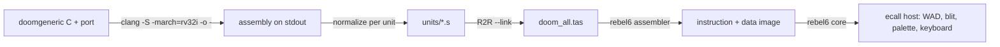

# REBEL-6 Doom pipeline

This document records the `feat/rebel6-pure` implementation: a 32-trit REBEL-6 core that runs
`doomgeneric` compiled from C, translated by the R2R reference tool, assembled and linked by the
new `rebel6` module, and executed with host `ecall` services.

## Claim

Doom (`doomgeneric`, C) is compiled with clang for RV32I, translated to REBEL-6 assembly by R2R,
assembled into 32-trit instructions, and executed by a Rust core with 24-trit words, 729
registers, Harvard instruction/data memories and the REBEL-6 instruction formats. The 21-trit ISA
and the DBT are not used on this path.

## Pipeline



## Implementation

| Path | Contents |
| :-- | :-- |
| `src/rebel6/word.rs` | `Word24`, balanced wrap modulo `3^24`, shifts, rotations, tritwise logic, majority/minority, flip and energy accounting |
| `src/rebel6/isa.rs` | Single source of the instruction set: one row per encoding with operation, mnemonic, format, opcode and function field, plus the lookups the encoder, the decoder, the assembler and the tests use |
| `src/rebel6/encoding.rs` | Seven instruction formats, encoder and decoder packed at two bits per trit in a `u64`, both driven by the `isa` table |
| `src/rebel6/mem.rs` | Byte/tryte addressed data memory with little-endian binary loads and stores |
| `src/rebel6/cpu.rs` | 729-register file, `X0` hardwired to zero, 74 architectural instructions, traps, Harvard fetch |
| `src/rebel6/asm.rs` | Two-pass `.tas` assembler: directives, labels, relocations, pseudo-instructions, BSS as NOBITS |
| `src/bin/rebel6_run.rs` | Runs a `.tas` image and reports registers and telemetry |
| `src/bin/rebel6_asm.rs` | Assembles a `.tas` image and reports its layout |
| `src/bin/rebel6_doom.rs` | Doom runner with the eleven `ecall` services |
| `scripts/setup_r2r.sh` | Clones the `setun-doom-compat` branch of the R2R fork and builds it |
| `vendor/RV32IToREBEL` | Translator and linker: `--link`, `--emit-map`, `--emit-syms`, `--emit-obj`, `--emit-image`, `--run-tests`, `--diff`, `--stats` |
| `scripts/build_rebel6_doom.py` | Compiles to stdout, normalizes each unit into `build/rebel6/units/<stem>.s`, and runs `R2R --link --emit-map --emit-syms` |

## Build and run

```bash
# Once per worktree: clone the R2R fork branch and build the translator.
./scripts/setup_r2r.sh

# Build the translator and the Rust binaries.
cargo build --release --bin rebel6_run --bin rebel6_asm --bin rebel6_doom

# Translate the guest.
python3 scripts/build_rebel6_doom.py

# Run until the second frame, saving PPM frames.
./target/release/rebel6_doom vendor/doomgeneric/riscv32/build/rebel6/doom_all.tas 2
```

The guest is headless: the host owns the WAD, the palette, the framebuffer and the keyboard. The
host clock is deterministic, one millisecond per 1000 retired instructions, so the startup path
does not depend on host speed. Frame 1 is the initial view; frame 2 is the first full E1M1 frame.

## Conformance

| Check | Result |
| :-- | :-- |
| Official RV32I tests, `vendor/RV32IToREBEL/RiscvTests/PreprocessedAssembly` | 37/37 pass |
| Dhrystone final register state | identical to the R2R simulator |
| Doom startup | reaches `D_DoomMain`, loads `DOOM1.WAD`, initializes video, sound, HUD and the level |
| Doom frame | 63,847 non-zero framebuffer bytes at frame 2, E1M1 rendered with HUD |
| Frame parity with the 21-trit reference | 97.5% of pixels identical (`compare -metric AE`) |
| `cargo test` | 85 library tests pass |

The instruction counts and trit-flip totals for Dhrystone differ from the reference simulator
because the two implementations lay data out differently and therefore execute different numbers
of string-loop iterations. The final architectural state is identical.

## Deviations from the reference tool

| Item | Reason |
| :-- | :-- |
| R2R parser accepts `symbol+offset` | Clang emits jump tables and aliases with addends; the reference parser accepted only bare symbols |
| `.string` quotes stripped | The reference assembler emitted the quote characters as string data |
| `.asciz` expanded to `.byte` | Octal escapes such as `\000` were decoded incorrectly by the normalization layer |
| Per-unit symbol scoping | The linker prefixes every symbol a unit does not declare `.globl` with the unit name, so two file-scope statics called `plr` (`am_map.c`, `hu_stuff.c`) or `anims` (`p_spec.c`, `wi_stuff.c`) keep separate addresses |
| Line map and symbol table | The linker consumes `.file` and `.loc`, annotates every expression with its C origin and writes both indexes: `--emit-map` records, per unit, the assembly line and the C file and line in effect, and `--emit-syms` records the emitted name, scope, unit, C line and original name. The build adds one `.file 1, "<source>"` line per unit so index 1 resolves to the C file |
| `__muldi3` implemented with shift-add | A 64-bit `*` lowers to a recursive `__muldi3` call on RV32I |
| `__mulsi3`, `__divsi3`, `__udivsi3`, `__modsi3`, `__umodsi3` added | The guest was built with `-march=rv32i`, without the M extension |
| Flat data space | The core populates one byte-addressed data window instead of the three-region D-ROM/D-RAM/MMIO map |
| Binary loads and stores | Doom uses the RV32I byte-addressed forms; ternary `lw.t`/`sw.t` are implemented but not used by this guest |

## Frame parity and the deterministic clock

Frame parity is only meaningful for changes that keep the guest image identical. The host clock is
deterministic, one millisecond per 1000 retired instructions, so any guest source change moves the
game's timeline relative to the blit index. A build that renders E1M1 at blit 2 can render it at
blit 4 with the same pixels: the errno change reached 63,847 non-zero pixels and a set palette at
blit 4, while the unmodified build reached them at blit 2.

Acceptance for a guest source change is therefore the first rendered frame with the level content
and the palette set, plus equal content at equal cycle budgets. Acceptance for a tooling change
that preserves the image, such as moving the build to `R2R --link`, stays exact: identical `.tas`
and identical frame bytes.

## Known limits

- The linker merges source-level units and resolves symbols by name; it does not consume ELF
  objects or relocation records, so unused code cannot be dropped the way `--gc-sections` drops it
  on the RV32IM path.
- `.bss` is NOBITS: it is reserved after all initialized data and never stored in the image. The
  Doom image keeps 4,357,942 data trytes and reserves 243,796 BSS trytes.
- `.align` and `.balign` are honoured. `.p2align`, which clang emits for every global, stays
  opt-in (`REBEL6_ASM_P2ALIGN=1`) because honouring it by default shifts the Doom image and the
  frame no longer renders, which points at a latent layout assumption in the guest.
- The data space is a single window starting after the instruction image; D-ROM and MMIO regions
  are not modeled.
- No interrupts, timers or privilege levels. `WFI.T` and `TRET.T` trap.
- Performance is interpreter-class: the second Doom frame arrives after roughly 31 million
  instructions, about 64 seconds on the development host.
- The player weapon sprite is not rendered, and a small number of masked-sprite and mid-texture
  pixels differ from the 21-trit reference. Solid walls, floors, ceilings, HUD and status bar
  match.
- R2R's own assembler aborts after writing the `.tas` because its fixed program size overflows;
  the build script treats the `.tas` as the product and ignores the later failure.
